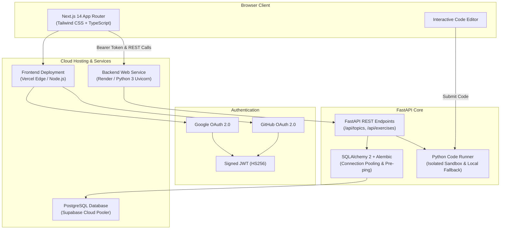

<div align="center">

# 🚀 CodeLab

**Learn to code topic-by-topic with interactive notes, an in-browser code editor, and instant test case evaluation.**

[](https://codelab-amber.vercel.app)
[](https://codelab-1r29.onrender.com/docs)
[](https://opensource.org/licenses/MIT)

<br/>

[](https://nextjs.org/)
[](https://fastapi.tiangolo.com/)
[](https://supabase.com/)
[](https://www.typescriptlang.org/)
[](https://tailwindcss.com/)
[](https://render.com)
[](https://vercel.com)

</div>

---

## 🌐 Live Deployments

| Component | Platform | Live URL | Status |
|---|---|---|---|
| **Frontend Web App** | Vercel | [codelab-amber.vercel.app](https://codelab-amber.vercel.app) |  |
| **Backend API Server** | Render | [codelab-1r29.onrender.com](https://codelab-1r29.onrender.com) |  |
| **API Interactive Docs** | Swagger UI | [codelab-1r29.onrender.com/docs](https://codelab-1r29.onrender.com/docs) |  |
| **Database** | Supabase | Managed PostgreSQL Cluster |  |

---

## ✨ Key Features

- 🌌 **Interactive 3D Experience**: Cinematic Three.js WebGL background with animated torus knot, floating core, dynamic starfield, and interactive 3D perspective hover cards.
- 📖 **Curated Concept Notes**: Clean, distraction-free markdown lessons explaining fundamental to intermediate programming topics in under two minutes.
- 💻 **Pro In-Browser Playground**: Syntax-highlighted CodeMirror 6 editor with draft autosave, execution timer (ms), confetti celebrations, and `Ctrl+Enter` / `Cmd+Enter` instant test execution.
- ⚡ **Gamification & Progression**: Full XP rewards engine, active daily streak tracker, level rank progression (Apprentice to Master), and unlockable achievement badges.
- 🤖 **Socratic AI Mentor**: 3-stage progressive hint system (Concept $\rightarrow$ Logic $\rightarrow$ Code Skeleton) guiding learners toward solutions without spoiling answers.
- 🧪 **Automated Test Evaluation**: User code executes securely against structured test cases (inputs and expected outputs) with timeout protection and test badges.
- 🔒 **Viewport-Locked Cyberpunk Auth**: Custom OAuth 2.0 sign-in page matching the 3D dark theme for **Google** and **GitHub** with zero-scroll responsive mobile design.
- 🛡️ **Zero-Downtime Fallback Resilience**: Built-in curriculum and profile fallback caching that guarantees instant rendering even during server cold starts.
- 📊 **Learner Dashboard**: Solved exercises, XP counters, and milestone achievement progress persisted across devices.
- 🌗 **Dark & Light Mode**: Flawless adaptive UI with high-contrast syntax themes and persistent preference toggle.
- 🔍 **Instant Search**: Rapid search filter across all curriculum topics and programming challenges.
- 🛡️ **Admin Portal**: Curriculum administration interface to add, edit, and curate topics and challenges.

---

## 🏗️ Architecture



---

## 🛠️ Tech Stack

### Frontend
- **Framework**: [Next.js 14](https://nextjs.org/) (App Router, Server Components & Server Actions)
- **Language**: [TypeScript](https://www.typescriptlang.org/)
- **Styling**: [Tailwind CSS](https://tailwindcss.com/)
- **Authentication**: [Auth.js / NextAuth v5](https://authjs.dev/) (Google & GitHub OAuth providers)
- **Tokens**: [jose](https://github.com/panva/jose) (Stateless HS256 JWT signing for backend communication)

### Backend
- **Framework**: [FastAPI](https://fastapi.tiangolo.com/) (Asynchronous Python API framework)
- **Server**: [Uvicorn](https://www.uvicorn.org/) (ASGI web server)
- **ORM & Migrations**: [SQLAlchemy 2.0](https://www.sqlalchemy.org/) & [Alembic](https://alembic.sqlalchemy.org/)
- **Postgres Drivers**: `psycopg` (v3) & `psycopg2-binary` with SSL pooling and auto-reconnect
- **Execution Engine**: Subprocess sandbox with CPU/Memory constraints & Docker isolation support
- **Testing**: [pytest](https://docs.pytest.org/) & HTTPX test client

### Database & Infrastructure
- **Database**: [Supabase](https://supabase.com/) PostgreSQL
- **Frontend Host**: [Vercel](https://vercel.com/)
- **Backend Host**: [Render](https://render.com/)

---

## 📚 Curriculum Topics

| # | Topic | Key Concepts | Exercises | Difficulty |
|---|---|---|:---:|:---:|
| 1 | **Python Basics** | Variables, data types, `input()`, f-strings, arithmetic | 2 | Easy |
| 2 | **Control Flow** | `if/elif/else`, boolean logic, `for` and `while` loops | 2 | Easy / Medium |
| 3 | **Strings** | Slicing, indexing, immutability, built-in string methods | 2 | Easy |
| 4 | **Functions & Scope** | `def`, return values, default parameters, local vs global scope | 3 | Easy / Medium |
| 5 | **Lists & Tuples** | Arrays, mutations, list comprehensions, tuple packing/unpacking | 3 | Easy / Medium |
| 6 | **Dictionaries & Sets** | Key-value hash maps, set operations, lookup efficiency | 3 | Easy / Medium |

---

## ⚡ Quick Start (Local Development)

### Prerequisites
- Python 3.10+
- Node.js 18+ and `npm`
- Git

### 1. Clone the Repository
```bash
git clone https://github.com/guruvishnuk/codelab.git
cd codelab
```

### 2. Backend Setup
```bash
cd codelab/backend

# Create and activate virtual environment
python -m venv .venv
# Windows:
.venv\Scripts\activate
# macOS/Linux:
source .venv/bin/activate

# Install dependencies
pip install -r requirements.txt

# Create environment configuration
cp .env.example .env

# Run FastAPI server
uvicorn app.main:app --reload --port 8000
```
Backend API will be live at `http://localhost:8000`.  
Swagger interactive docs at `http://localhost:8000/docs`.

### 3. Frontend Setup
Open a new terminal window:
```bash
cd codelab/frontend

# Install dependencies
npm install

# Setup environment variables
cp .env.local.example .env.local

# Start Next.js development server
npm run dev
```
Open [http://localhost:3000](http://localhost:3000) in your browser.

---

## 🧪 Running Tests

The backend includes a comprehensive automated test suite verifying API routes, exercise runners, and auth validation:

```bash
cd codelab/backend
pytest
```

---

## 🚀 Deployment Guide

### 1. Database (Supabase)
1. Create a project at [supabase.com](https://supabase.com).
2. Go to **Project Settings** → **Database** → **Connection String** → **URI**.
3. Copy the PostgreSQL URI for use in Render.

### 2. Backend (Render)
1. Create a new **Web Service** on [Render.com](https://render.com) connected to this repository.
2. Configure settings:
   - **Root Directory**: `codelab/backend`
   - **Build Command**: `pip install -r requirements.txt`
   - **Start Command**: `uvicorn app.main:app --host 0.0.0.0 --port $PORT`
3. Add Environment Variables:
   - `DATABASE_URL`: *(Your Supabase PostgreSQL URI)*
   - `FRONTEND_ORIGIN`: `https://codelab-amber.vercel.app`
   - `USE_DOCKER_SANDBOX`: `false`

### 3. Frontend (Vercel)
1. Import repository into [Vercel](https://vercel.com).
2. Set **Root Directory** to `codelab/frontend`.
3. Add Environment Variables:
   - `NEXT_PUBLIC_API_URL`: *(Your Render service URL, e.g., `https://codelab-1r29.onrender.com`)*
   - `AUTH_SECRET`: *(32-character random string)*
   - `AUTH_GOOGLE_ID` & `AUTH_GOOGLE_SECRET`: *(From Google Cloud Console)*
   - `AUTH_GITHUB_ID` & `AUTH_GITHUB_SECRET`: *(From GitHub OAuth Apps)*
   - `AUTH_URL`: `https://codelab-amber.vercel.app`
   - `AUTH_TRUST_HOST`: `true`

---

## 📄 License

This project is open-source under the [MIT License](LICENSE).
Feel free to fork, customize, and build your own learning platform!

<div align="center">
Made with ❤️ by <a href="https://github.com/guruvishnuk">Guru Vishnu</a>
</div>

